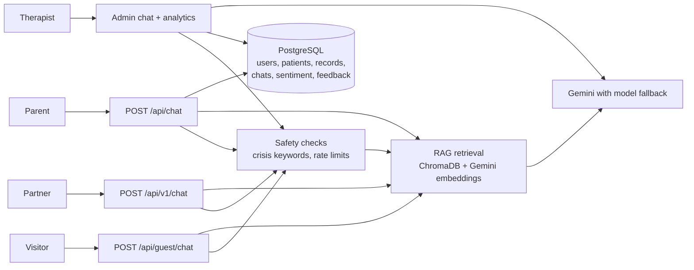

# MelodyCare

An AI-assisted parent support system for a (fictional) child and family psychology centre. It combines a Retrieval-Augmented Generation (RAG) chatbot, a therapist analytics dashboard and a small public API. Built as an individual Final Year Project at TAR UMT.

> **All organisations, people, addresses, phone numbers and patient records in this repository are fictional** and exist only for demonstration. This is a proof of concept, not a medical device, and it has not been clinically validated.
 
## Live demo

**https://melodycare-m14l.onrender.com** 

| Role | Email | Password |
|---|---|---|
| Parent | `demo.parent@melodycare.my` | `demoparent` |
| Therapist | `demo.admin@melodycare.my` | `demoadmin` |

**Try the complaint triage:** log in as the parent and send a message such as
"The therapist arrived 40 minutes late twice this month and never apologised" or
"I can't do this anymore, nothing works and everyone is useless!!!", then log in as the therapist to see how each complaint was classified.

All data is synthetic. These accounts are shared by everyone, so please don't enter personal information. The therapist account only shows the demo parent's data, and chat limits apply to each account.

## What it does

| Who | What they get |
|---|---|
| **Visitor** (no login) | A ChatGPT-style home page that answers questions about the centre (location, parking, hours, services, team) and gives general parenting guidance. Nothing is saved and no child records are used. |
| **Parent** (login) | A personalised assistant that knows the parent's child and treatment history, with a child info card and saved chat sessions. |
| **Therapist / admin** (login) | A dashboard with sentiment trends, an overview of families, a complaint review that separates emotional venting from concerns about a therapist, and an assistant that can answer questions about the data. |
| **Partner developer** (API key) | `POST /api/v1/chat` plus an embeddable chat widget, with per-key quotas. |

## How it works



- **RAG**: knowledge-base documents are chunked and embedded into ChromaDB; the closest chunks are added to the prompt, and the answer shows which files it used.
- **Personalisation**: a parent's child record is added to the prompt for logged-in parents (it is not retrieved from the vector store).
- **Sentiment analysis**: each parent message is scored by the LLM and stored, which feeds the therapist dashboard.
- **Complaint triage**: when a parent complains, the LLM labels who it is about (therapist, centre, the child's progress, the parent's own situation), how emotional the parent is, and whether it is specific. Simple rules, which also compare the message with the parent's usual mood, then sort it into *therapist concern*, *emotional venting*, *unclear* or *not about the therapist*, so a parent's bad day is not counted against a therapist. Flags are for human review, not a verdict.
- **Safety**: crisis keywords (English, Malay, Chinese) are detected before anything else. On the public chat and the API a fixed helpline message is returned without calling the LLM. In the parent chat a helpline card is always shown, and a fixed reply is used if the model fails. Crisis messages are never blocked by rate limits. A first-visit disclaimer plus per-visitor, per-account and per-key rate limits protect users and the API quota. This detection is keyword-based and can miss cases.
- **Reliability**: short retries, timeouts and automatic fallback across several Gemini models.
- **API keys**: *server* keys are refused if sent from a browser; *browser* keys only work from the websites registered for them. Each key has its own quota, plus a global daily cap.

## Tech stack

Python 3.13, FastAPI, SQLAlchemy, PostgreSQL (SQLite works for trying it out), LangChain, ChromaDB, Google Gemini API, JWT (python-jose), bcrypt, plain HTML/CSS/JavaScript front end. Deployed on Render.

## Run it locally

```bash
python -m venv venv
venv\Scripts\activate            # Windows   (macOS/Linux: source venv/bin/activate)
pip install -r requirements.txt
copy .env.example .env           # macOS/Linux: cp .env.example .env, then edit .env
python src/seed.py               # creates fictional demo data and prints demo logins once
python src/create_demo_accounts.py   # optional: creates the two public demo accounts
uvicorn src.main:app --reload --port 8002
```

Open http://localhost:8002. On the first start the vector store is built from `data/knowledge_base/` (needs `GOOGLE_API_KEY`; takes a minute).

| Page | Purpose |
|---|---|
| `/` | Visitor chat |
| `/about.html` | About the (fictional) centre |
| `/login.html` | Parent / therapist login |
| `/docs` | Interactive API documentation (auto-generated by FastAPI) |

## Public API

```bash
curl -X POST https://YOUR-HOST/api/v1/chat \
  -H "X-API-Key: mc_..." -H "Content-Type: application/json" \
  -d '{"message": "Do you have parking?"}'
```

Returns `answer`, `sources`, `crisis` and `remaining_today`. To embed the chat box on a website:

```html
<script src="https://YOUR-HOST/widget.js" data-key="mc_..." data-title="Parent support"></script>
```

A partner can have its own organisation details in `data/tenants/<key-name>.txt` (see `_example.txt`).

## Project structure

```
src/        FastAPI app, RAG pipeline, safety checks, complaint triage, public API
static/     HTML pages and the chat widget
data/       knowledge base documents (the vector store is rebuilt automatically)
```

## Screenshots


## Limitations

Keyword-based crisis detection; in-memory rate limits that reset on restart; no formal evaluation of answer quality is included in this repository; the helpline number shown (Helpline HEAL 15555) should be verified before any real-world use. Source files are shown when an answer is generated but are not stored with the chat history. Complaint triage relies on LLM labels plus hand-set thresholds and has not been evaluated against labelled data yet; it is a flag for human review, not an assessment of a therapist.
