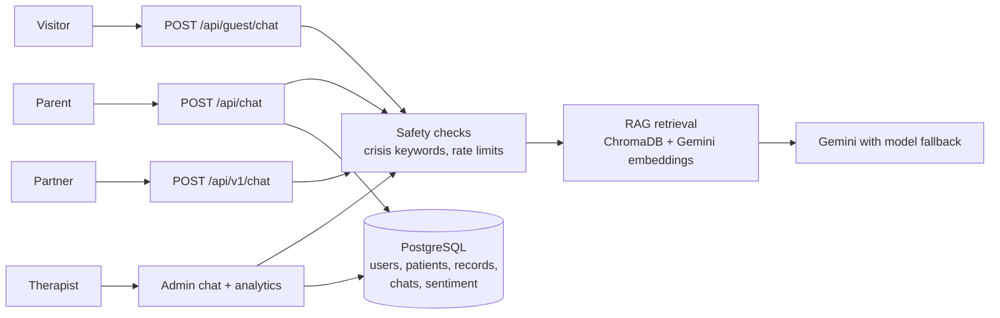

# MelodyCare

An AI-assisted parent support system for a (fictional) child and family psychology centre. It combines a Retrieval-Augmented Generation (RAG) chatbot, a therapist analytics dashboard and a small public API. Built as an individual Final Year Project at TAR UMT.

> **All organisations, people, addresses, phone numbers and patient records in this repository are fictional** and exist only for demonstration. This is a proof of concept, not a medical device, and it has not been clinically validated.

## What it does

| Who | What they get |
|---|---|
| **Visitor** (no login) | A ChatGPT-style home page that answers questions about the centre (location, parking, hours, services, team) and gives general parenting guidance. Nothing is saved and no child records are used. |
| **Parent** (login) | A personalised assistant that knows the parent's child and treatment history, with saved chat sessions. |
| **Therapist / admin** (login) | A dashboard with sentiment trends, an overview of families, therapist performance, and an assistant that can answer questions about the data. |
| **Partner developer** (API key) | `POST /api/v1/chat` plus an embeddable chat widget, with per-key quotas. |

## How it works



- **RAG**: knowledge-base documents are chunked and embedded into ChromaDB; the closest chunks are added to the prompt, and the answer shows which files it used.
- **Personalisation**: a parent's child record is added to the prompt for logged-in parents (it is not retrieved from the vector store).
- **Sentiment analysis**: each parent message is scored by the LLM and stored, which feeds the therapist dashboard.
- **Safety**: crisis keywords (English, Malay, Chinese) trigger a fixed helpline message *without* calling the LLM, so it works even when the model is unavailable. A first-visit disclaimer and per-visitor rate limits protect users and the API quota. This detection is keyword-based and can miss cases.
- **Reliability**: short retries, timeouts and automatic fallback across several Gemini models.
- **API keys**: *server* keys are refused if sent from a browser; *browser* keys only work from the websites registered for them. Each key has its own quota, plus a global daily cap.

## Tech stack

Python 3.13, FastAPI, SQLAlchemy, PostgreSQL (SQLite works for trying it out), LangChain, ChromaDB, Google Gemini API, JWT (python-jose), bcrypt, plain HTML/CSS/JavaScript front end. Deployed on Render.

## Run it locally

```bash
python -m venv venv
venv\Scripts\activate            # Windows   (macOS/Linux: source venv/bin/activate)
pip install -r requirements.txt
copy .env.example .env           # macOS/Linux: cp .env.example .env, then edit .env
python src/seed.py               # creates fictional demo data and prints demo logins once
uvicorn src.main:app --reload --port 8002
```

Open http://localhost:8002. On the first start the vector store is built from `data/knowledge_base/` (needs `GOOGLE_API_KEY`; takes a minute).

| Page | Purpose |
|---|---|
| `/` | Visitor chat |
| `/about.html` | About the (fictional) centre |
| `/login.html` | Parent / therapist login |
| `/docs` | Interactive API documentation (auto-generated by FastAPI) |

## Public API

```bash
curl -X POST https://YOUR-HOST/api/v1/chat \
  -H "X-API-Key: mc_..." -H "Content-Type: application/json" \
  -d '{"message": "Do you have parking?"}'
```

Returns `answer`, `sources`, `crisis` and `remaining_today`. To embed the chat box on a website:

```html
<script src="https://YOUR-HOST/widget.js" data-key="mc_..." data-title="Parent support"></script>
```

A partner can have its own organisation details in `data/tenants/<key-name>.txt` (see `_example.txt`).

## Project structure

```
src/        FastAPI app, RAG pipeline, safety checks, public API
static/     HTML pages and the chat widget
data/       knowledge base documents (the vector store is rebuilt automatically)
```

## Screenshots

_Add screenshots here: visitor chat, parent chat, therapist dashboard, `/docs`._

## Limitations

Keyword-based crisis detection; in-memory rate limits that reset on restart; no formal evaluation of answer quality is included in this repository; the helpline number shown (Helpline HEAL 15555) should be verified before any real-world use.
